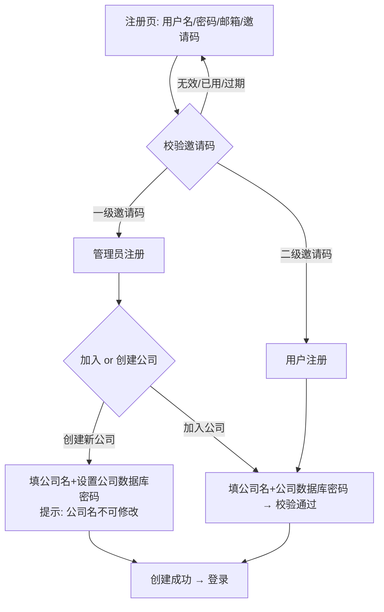
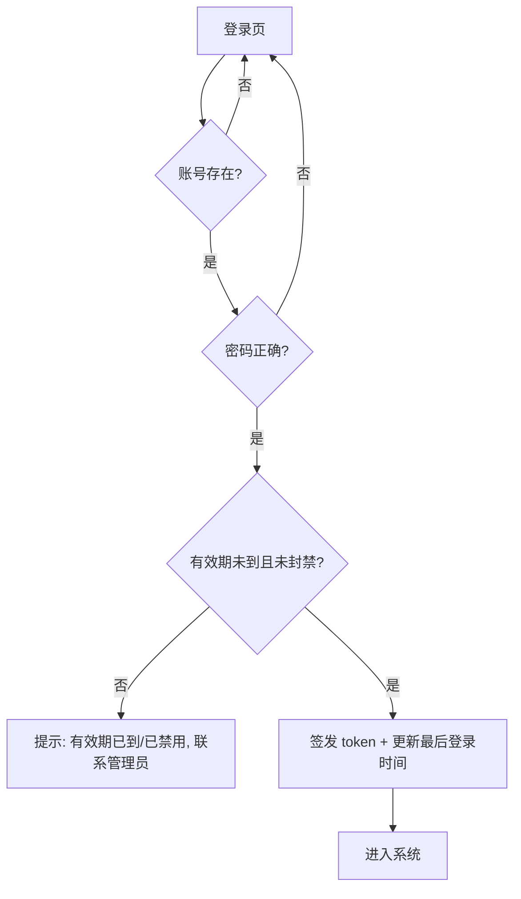

# 需求分析文档 — 登录认证、三级权限、图片数据库与图片库管理

> 版本：v1.0（2026-08-06）
> 状态：待实现（本文件用于指导下一轮对话完成全部功能开发）
> 对应项目：AI 图片生成器（React + FastAPI，前后端分离）

---

## 一、需求总览

| 模块 | 内容 | 优先级 |
| ------ | ------ | -------- |
| A. 登录与注册 | 用户名+密码登录；邮箱+邀请码注册；密码/API Key 加密存储 | P0 |
| B. 三级权限 | 最高级管理员(admin) > 管理员 > 用户 | P0 |
| C. 公司体系 | 管理员可加入/创建公司；同公司共用同一图片库；公司数据库密码可改 | P0 |
| D. 邀请码体系 | 一级邀请码→管理员；二级邀请码→用户；一次性作废；带有效期 | P0 |
| E. 用户管理 | 超管/管理员管理邀请码与账号、注册/登录时间、有效期、封禁、延期 | P0 |
| F. 图片数据库 | 图片统一入库（电商模板/切片模板/海报底图），按公司隔离，增删改查 | P0 |
| G. 图片库管理页 | 前端独立可操作的图片库页面，三类图片分开管理，含表头字段 | P0 |
| H. 营销海报改造 | 支持"保存底图/选用现有底图/预览区自由拖拽素材位置" | P0 |
| I. 生成器改造 | 电商/切片的"上传模板"移除，改为从图片库选用 | P1 |

---

## 二、现状梳理（改造基础）

### 2.1 后端（FastAPI，`backend/`）

- 入口 `backend/main.py`：约 23 个路由；模块加载即启动定时清理线程（`scheduled_cleanup`，每 6h 清理 uploads/output 超 24h 文件，白名单 `final_result.png/poster_result.png/slice_result.png/poster_base.png`）。
- 全局 API Key 配置：`backend/api_config.py`，Fernet 加密存 `主目录/data/api_config.json`（字段 `api_key_encrypted`），密钥 `data/.secret_key`；提供 `transit_encrypt/transit_decrypt`（XOR 混淆）、`mask_api_key`、`record_usage`。
- 全局图片客户端：`main.py` 中 `client = BailianImageClient()`，`refresh_client()` 在改 Key 后重建；**当前是全局单例，改造后需改为"按当前登录用户动态取 API Key"**。
- 模板相关接口（**改造目标**）：
  - `GET /api/templates`（电商模板列表，读 `图/电商主图/模板图/`）
  - `GET /api/slice-templates?orientation=`（切片模板列表，读 `图/营销切片/模板图/横板|竖版/`）
  - `POST /api/upload-template`（上传模板，type: ecommerce/slice + orientation）
  - `POST /api/rename-template`（重命名模板）
- 静态挂载：`/style-images` → 电商模板目录；`/slice-images` → 切片模板目录；`/uploads`、`/output`。
- 海报流程：`POST /api/generate-poster`（异步任务，存 `poster_tasks`）→ 第1轮文生图出底图 → 第2轮 `composite_poster` 按**固定位置**合成 logo/二维码/品牌图 → `GET /api/generate-poster-progress/{task_id}` 轮询。
- 电商/切片为前端 Canvas 直接导出（`POST /api/generate-ecommerce-final`、`POST /api/upload-slice-result`）。

### 2.2 前端（React+Vite，`frontend/`）

- 路由（`src/App.tsx`）：`/`(Home)、`/ecommerce`、`/poster`、`/slice`。无登录概念、无路由守卫。
- 状态：`ApiConfigContext` 全局提供 API 配置；`Toast`；无鉴权拦截器。
- `src/api/api.ts`：axios 封装，`API_BASE='/api'`，未带 token。
- 模板选择 UI：`Ecommerce.tsx`（约 700-780 行"🎨 选择模板"区块，含上传模板 + 重命名）、`Slice.tsx`（约 340-390 行区块，含上传模板 + 重命名 + "不使用模板"）。
- 海报页 `Poster.tsx`：上传 logo/二维码/品牌图 → 输入描述 → 生成；预览区只读，素材位置由后端固定。
- 样式风格：白底卡片 + 圆角(8~16px) + 柔和阴影 `0 2px 12px rgba(0,0,0,0.06)`，主色 `#4f6ef7`（电商）、`#8b5cf6`（海报）、`#f97316`（切片），字体 `-apple-system, BlinkMacSystemFont, "Segoe UI", "Microsoft YaHei", sans-serif`，背景 `#f5f6fa`。
- 现有工具：`src/utils/crypto.ts` 的 `transitEncrypt`（XOR 混淆，登录时密码/Key 传输可复用同思路）。

### 2.3 部署

- 线上：`http://<服务器IP>:8084`，nginx 反代 `/api /uploads /output /style-images /slice-images` → `127.0.0.1:8005`（uvicorn，systemd `image-conversion.service`）。
- 本地：后端 8003 / 前端 5176，vite 代理 `/api` → 8003。

---

## 三、功能需求详述

### 3.1 登录与注册

**登录**

- 字段：用户名、密码。
- 登录成功后返回 token（建议 JWT）+ 用户基本信息（用户名、角色、公司、有效期、最后登录时间等）。
- 校验：密码正确、账号未到期（`valid_until` 到期禁止登录）、账号未封禁。
- 到期提示：到期被禁登录时，前端需明确提示"账号有效期已到，请联系管理员延长有效期"。

**注册**

- 字段：用户名、密码、邮箱、邀请码。
- 流程：
  1. 校验邀请码有效（存在、未使用、未过期）。
  2. 按邀请码级别确定角色：一级→管理员，二级→用户。
  3. 管理员注册：需在"加入公司"与"创建新公司"二选一。
  4. 用户注册：仅能"加入公司"。
  5. 用户名唯一；邮箱唯一（建议）；邀请码绑定后立即作废（`status='used'`）。
  6. 注册成功后自动继承邀请码的有效期作为账号 `valid_until`。

**公司绑定**

- 加入公司：输入**公司名称 + 公司数据库密码**，与库中公司校验通过后加入。
- 创建新公司（仅管理员）：输入**公司名称 + 设置公司数据库密码**。
- **注册时公司名填写后不可修改**（注册界面需明确提示"公司名提交后不可修改"）。
- 用户权限绑定 `company_id`，后续图片库按此隔离。

**最高级管理员（种子账号）**

- 用户名 `admin`，密码 `<SUPER_ADMIN_PASSWORD 环境变量>`，公司"我的公司"，公司数据库密码 `<SUPER_ADMIN_PASSWORD 环境变量>`。
- 注册/首次启动时自动创建（无需邀请码）。
- 权限：登录后可分发一级/二级邀请码；用户管理；可查看/清除/延期账号。

### 3.2 三级权限

| 角色 | 权限 |
| ------ | ------ |
| 最高级管理员 (super_admin) | 一切权限；分发一级/二级邀请码；管理所有管理员及用户账号；清除/延期；删除管理员时**级联删除其下用户** |
| 管理员 (admin) | 分发二级邀请码；管理本公司/本人邀请码关联的用户账号；清除/延期；修改公司数据库密码；图片库增删改查 |
| 用户 (user) | 图片库增删改查（本公司范围内）；使用生成器 |

> 权限分级"目前仅在图片数据库上有区分"：即以**公司为单位**隔离图片库；页面权限（用户管理页仅 super_admin/admin 可见）属于管理功能自然延伸。

### 3.3 邀请码体系

- 一级邀请码：super_admin 创建，供管理员注册；可用 **super_admin 或管理员** 创建？→ 否，一级仅 super_admin 可建（需求："最高级管理员登录后可分发一级邀请码用于管理员的注册，也可分发二级邀请码；管理员可分发二级邀请码"）。
- 二级邀请码：super_admin、admin 均可创建，供用户注册。
- 属性：随机码（建议 6~10 位大写字母+数字）、级别(level)、状态(unused/used)、创建者、有效期 `valid_until`、使用时间、使用者。
- **一次性**：绑定成功即作废；重复使用/过期均拒绝。
- **有效期联动**：创建邀请码时设定有效期 → 注册出的账号 `valid_until` 同该有效期；有效期到后账号禁登。

### 3.4 用户管理界面（super_admin / admin）

- 列出：邀请码列表（码、级别、状态、创建者、有效期、使用者）与账号列表（用户名、角色、公司、邮箱、注册时间、最后登录时间、有效期、状态）。
- 操作：
  - 创建邀请码（选级别 + 有效期）。
  - 作废未使用的邀请码（可选）。
  - 延长账号有效期（`extend`）。
  - 清除/封禁到期账号（`disable` / `delete`）。
  - **super_admin 删除管理员时，级联删除该管理员名下通过其邀请码注册的用户账号**（注意：按"邀请码创建者"关联，即 `created_by`）。
- 到期提醒：登录/使用过程中提示"有效期将于 X 到期 / 已到期请联系管理员"。

### 3.5 图片数据库（按公司隔离）

- 存储三类图片：电商主图模板(ecommerce)、营销切片模板(slice，分横板/竖版)、营销海报底图(poster_base)。
- 每张图片记录：所属公司、分类、图片名、版型(orientation: horizontal/vertical)、存储文件名/路径、大小、上传者、上传时间、更新时间。
- **同一公司账号共用同一图片库**：所有图片接口按 `company_id` 过滤（super_admin 归属最高级公司）。
- 文件物理存储：建议迁移/统一到 `data/image_library/{company_id}/{category}/`（原 `图/` 目录作为**种子数据**导入一次后不再直接作为增删改目标）。原静态挂载 `/style-images`、`/slice-images` 需改为指向图片库目录，或改为走鉴权接口（推荐后者，保障权限隔离）。

### 3.6 图片库管理页面（前端）

- 独立页面，路由建议 `/library`，Header 增加入口。
- 顶部按分类 Tab 分开管理：**电商模板 / 切片模板（再分横板/竖版）/ 海报底图**。
- 表格字段（表头）：图片（缩略图）、图片名（可重命名）、版型（横板/竖版）、上传时间、（可选：大小、上传者）、操作（下载 / 重命名 / 删除）。
- 操作：
  - 新增：上传图片（选分类 + 版型 + 命名）→ 入库。
  - 查询：按分类/版型/关键字筛选。
  - 修改：重命名、改版型。
  - 删除：删除记录 + 物理文件（删除前二次确认）。
- 电商/切片生成器不再提供上传模板，改为从图片库读取选用。

### 3.7 营销海报生成器改造（重点）

**保留底图**

- 每次生成完成后，用户选择是否保留**本次 AI 生成的底图**（`pass_1_base.png`，即第1轮文生图产物，**不是最终合成海报**）。
- 选择保留 → 弹窗命名 → 存入图片库（`poster_base` 分类，归属当前用户公司）。

**选用现有底图**

- 海报页新增开关"使用现有底图"。
- 不勾选：维持现有逻辑（文生图出底图 + 固定位置合成），并隐藏底图选择区。
- 勾选：显示本公司 `poster_base` 图片库供选用；**隐藏"描述海报内容"模块**（不再文生图，直接以所选底图合成）。
- 预览区（参考电商/切片预览交互）：底图为所选底图，**用户可自由拖拽 logo、二维码、品牌图位置**（含缩放）。
- 点击生成：跳过文生图，直接按**预览区中的位置与内容**合成（后端 `composite_poster` 需支持自定义素材位置参数 x/y/w/h）。

**接口改造**

- `POST /api/generate-poster` 增加参数：`use_existing_base: bool`、`base_image_id`（选用库中底图）、素材位置参数（logo/qr/brand 的 x,y,w,h，可选）。
- 新增：`POST /api/poster-bases`（保存底图：name + 图片文件 → 入图片库）。
- 新增：`GET /api/poster-bases`（列出本公司底图，或复用图片库接口 `GET /api/images?category=poster_base`）。

### 3.8 API Key 与账户绑定

- 每个账户可单独绑定 API Key；密码、API Key 均加密存储。
- 现有全局 `data/api_config.json` 方案需升级为**按用户存储**：
  - 建议在 `users` 表加 `api_key_encrypted`（沿用 Fernet 加密）、`api_base_url`、`api_model`。
  - AI 调用时（`require_api_key`、`client` 创建）改为从**当前登录用户**取 Key。
  - 兼容：super_admin（admin）首次登录可引导绑定；旧全局 Key 可迁移到 admin 账户或保留为兜底。
- 前端 `ApiConfigContext` / `ApiSettingsModal` 改造：绑定到当前登录账户（保存到该用户的 API 设置），仍加密/掩码展示。

---

## 四、业务流程

### 4.1 注册流程图



### 4.2 登录流程图



### 4.3 海报"选用底图"流程

```mermaid
flowchart TD
    A[海报页] --> B{勾选使用现有底图?}
    B -- 否 --> C[输入描述 → 文生图出底图]
    C --> D[预览区(默认位置) → 生成 → 合成]
    B -- 是 --> E[显示本公司 poster_base 底图列表]
    E --> F[选底图 → 隐藏描述模块]
    F --> G[预览区可拖拽 logo/二维码/品牌图位置]
    G --> H[点击生成 → 按预览位置合成]
    D --> I{是否保留本次底图?}
    H --> I
    I -- 保留 --> J[命名 → 存入图片库 poster_base]
    I -- 不保留 --> K[结束]
```

---

## 五、数据模型设计（SQLite）

> 采用 SQLite（文件 `主目录/data/app.db`），新增依赖建议：`pyjwt`、`passlib[bcrypt]`（或 `bcrypt`）。数据文件与现有 `api_config.json` 同目录，保持备份/自愈习惯一致（参考现有 `_ensure_data_files` 风格，删除后自动重建 + 种子数据）。

### 5.1 companies（公司）

| 字段 | 类型 | 说明 |
| ------ | ------ | ------ |
| id | INTEGER PK | |
| name | TEXT UNIQUE | 公司名，创建后不可改 |
| db_password_hash | TEXT | 公司数据库密码（bcrypt） |
| created_at | TEXT | |
| created_by | INTEGER | 创建人 user_id |

### 5.2 users（账号）

| 字段 | 类型 | 说明 |
| ------ | ------ | ------ |
| id | INTEGER PK | |
| username | TEXT UNIQUE | |
| password_hash | TEXT | bcrypt |
| email | TEXT UNIQUE | |
| role | TEXT | super_admin / admin / user |
| company_id | INTEGER FK | 归属公司 |
| invite_code_id | INTEGER NULL | 注册所用邀请码 |
| created_by | INTEGER NULL | 邀请码创建者（级联删除依据） |
| api_key_encrypted | TEXT | 本账户 API Key（Fernet 加密） |
| api_base_url | TEXT | |
| api_model | TEXT | |
| created_at | TEXT | 注册时间 |
| last_login_at | TEXT | 最后登录时间 |
| valid_until | TEXT | 有效期（到点禁登） |
| status | TEXT | active / disabled |

### 5.3 invite_codes（邀请码）

| 字段 | 类型 | 说明 |
| ------ | ------ | ------ |
| id | INTEGER PK | |
| code | TEXT UNIQUE | 随机码 |
| level | INTEGER | 1=管理员 / 2=用户 |
| status | TEXT | unused / used |
| created_by | INTEGER FK | 创建者 user_id |
| valid_until | TEXT | 有效期（联动账号） |
| used_by | INTEGER NULL | 使用者 user_id |
| created_at | TEXT | |
| used_at | TEXT | |

### 5.4 images（图片库）

| 字段 | 类型 | 说明 |
| ------ | ------ | ------ |
| id | INTEGER PK | |
| company_id | INTEGER FK | 公司隔离键 |
| category | TEXT | ecommerce / slice / poster_base |
| orientation | TEXT | horizontal / vertical（poster_base 可为空/其他） |
| name | TEXT | 图片名（可改） |
| filename | TEXT | 物理文件名 |
| filepath | TEXT | 相对路径（含 category/orientation） |
| size | INTEGER | 字节 |
| uploaded_by | INTEGER FK | 上传者 |
| created_at | TEXT | 上传时间 |
| updated_at | TEXT | |

### 5.5 种子数据（首次启动自愈重建）

1. 公司：我的公司（db_password_hash = bcrypt("<SUPER_ADMIN_PASSWORD 环境变量>")）。
2. 用户：admin / <SUPER_ADMIN_PASSWORD 环境变量> / super_admin / 归属上述公司，有效期长（如 2099-12-31）。

---

## 六、API 设计

> 统一前缀 `/api`；除注册/登录/公司列表外，均需登录（`Authorization: Bearer <token>`）；图片库接口按公司过滤。

### 6.1 认证

| 方法 | 路径 | 说明 |
| ------ | ------ | ------ |
| POST | /api/auth/register | 注册：username,password,email,invite_code, action(join/create), company_name, company_db_password |
| POST | /api/auth/login | 登录：username,password → {token, user} |
| GET | /api/auth/me | 当前用户信息（含有效期提示） |
| POST | /api/auth/logout | 退出（可选） |
| PUT | /api/auth/api-key | 绑定/更新本账户 API Key（加密存储；key 走 XOR 混淆传输） |
| GET | /api/auth/api-key | 本账户 Key 掩码/状态 |
| PUT | /api/auth/password | 修改自己的密码（可选） |

### 6.2 公司

| 方法 | 路径 | 说明 |
| ------ | ------ | ------ |
| GET | /api/companies | 公司列表（供注册时"加入公司"下拉） |
| POST | /api/companies | （注册时创建公司走 auth/register，不单开） |
| PUT | /api/companies/{id}/db-password | 管理员修改公司数据库密码（需旧密码校验） |

### 6.3 邀请码（super_admin / admin）

| 方法 | 路径 | 说明 |
| ------ | ------ | ------ |
| POST | /api/invite-codes | 创建：level, valid_until → 返回 code（一级仅 super_admin） |
| GET | /api/invite-codes | 列表（本人创建的；super_admin 看全部） |
| DELETE | /api/invite-codes/{id} | 作废未使用邀请码 |

### 6.4 用户管理（super_admin / admin）

| 方法 | 路径 | 说明 |
| ------ | ------ | ------ |
| GET | /api/admin/users | 账号列表（注册时间/最后登录/有效期/状态） |
| POST | /api/admin/users/{id}/extend | 延长有效期（new_valid_until） |
| POST | /api/admin/users/{id}/disable | 禁用账号 |
| DELETE | /api/admin/users/{id} | 删除账号（super_admin 删 admin 时级联删除其 created_by=该admin 的用户） |

### 6.5 图片库（登录，按公司隔离）

| 方法 | 路径 | 说明 |
| ------ | ------ | ------ |
| GET | /api/images | 列表：category, orientation, keyword → 分页 + 缩略图 |
| POST | /api/images | 上传：file, category, orientation, name |
| PUT | /api/images/{id} | 修改：name / orientation |
| DELETE | /api/images/{id} | 删除（记录 + 物理文件） |
| GET | /api/images/{id}/file | 原始文件（下载/预览） |
| GET | /api/images/{id}/thumbnail | 缩略图（或列表内联 base64） |

### 6.6 生成器改造

| 方法 | 路径 | 说明 |
| ------ | ------ | ------ |
| GET | /api/templates | 改造为从图片库(ecommerce)读取（仍可保留兼容） |
| GET | /api/slice-templates | 改造为从图片库(slice)读取 |
| POST | /api/generate-poster | 增加 use_existing_base/base_image_id/素材位置参数 |
| POST | /api/poster-bases | 保存海报底图：name + file → 图片库 poster_base |
| （移除） | /api/upload-template, /api/rename-template | 由图片库接口替代（前端移除对应 UI） |

---

## 七、前端页面设计

### 7.1 登录/注册页 `/login`

- 居中卡片，渐变主色（沿用 `#4f6ef7 → #8b5cf6`），字段：用户名、密码；Tab 切换"登录 / 注册"。
- 注册表单：用户名、密码、确认密码、邮箱、邀请码；校验邀请码级别后显示对应公司区：
  - 一级（管理员）：单选框"创建新公司 / 加入公司"；创建→公司名+设置数据库密码（提示"公司名提交后不可修改"）；加入→公司名+公司数据库密码（下拉选公司）。
  - 二级（用户）：仅"加入公司"（公司名+公司数据库密码）。
- 登录成功 → 存 token 到 localStorage → 跳首页。

### 7.2 路由守卫与鉴权

- 新增 `AuthContext`：token、user、login/logout、hasRole。
- axios 拦截器：附加 `Authorization: Bearer`；401 → 清 token 跳 `/login`。
- 路由守卫：未登录访问任何页 → `/login`；`/admin/*` 仅 super_admin/admin；到期/禁用拦截提示。

### 7.3 Header 改造

- 左侧：现有生成器下拉 + 标题。
- 新增：图片库入口（`/library`）、用户管理入口（`/admin/users`，仅 super_admin/admin）、用户名徽标 + 角色、退出登录。
- 保留：API 设置按钮（改为绑定当前账户）、Token 徽标。

### 7.4 图片库管理页 `/library`

- Tab：电商模板 / 切片模板（横板/竖版子切）/ 海报底图。
- 表格：缩略图、图片名（行内编辑重命名）、版型、上传时间、（大小/上传者）、操作（下载/重命名/删除）。
- 上传弹窗：文件 + 分类 + 版型 + 命名。
- 删除二次确认。
- 风格与现有卡片/表格风格统一。

### 7.5 用户管理页 `/admin/users`

- Tab：邀请码管理 / 账号管理。
- 邀请码：创建（级别+有效期）、列表（码/级别/状态/创建者/有效期/使用者/时间）、作废。
- 账号：列表（用户名/角色/公司/注册时间/最后登录/有效期/状态）、延长有效期、禁用、删除（级联提示）。

### 7.6 生成器页面改造

- `Ecommerce.tsx`：删除"上传新模板"UploadZone 与重命名 UI，模板列表改从图片库接口取（仍显示缩略图供选择）。
- `Slice.tsx`：同上；保留"不使用模板"。
- `Poster.tsx`：
  - 新增开关"使用现有底图"。
  - 勾选后：隐藏描述文本区；显示本公司 poster_base 底图选择；预览区可拖拽 logo/二维码/品牌图（参照 Ecommerce/Slice 的 CanvasOverlay 拖拽实现，可用 Ecommerce.tsx 的 `canvasRef`/拖拽逻辑为范本）。
  - 生成后：弹出"是否保留本次底图？"→ 命名 → 上传保存。

---

## 八、关键改造点与影响清单

1. **全局 API Key → 按账户绑定**（影响 `main.py` 的 `client/require_api_key/refresh_client`、`api_config.py`、前端 `ApiConfigContext/ApiSettingsModal`）。
2. **新增认证层**（`backend/auth.py`：密码哈希、JWT、`get_current_user` 依赖）。
3. **新增数据层**（`backend/database.py`：建表 + 种子；`backend/models.py`：DAO）。
4. **新增路由模块**（auth / admin / images / companies），`main.py` 挂载；注意现有 `@app.*` 装饰器勿被吞（历史教训）。
5. **模板存储迁移**：`图/` 下现有模板导入 `images` 表（按公司=我的公司）；静态挂载 `/style-images`、`/slice-images` 改指向图片库存储目录或改走鉴权接口（推荐鉴权接口，避免越权访问）。
6. **海报异步任务**：任务上下文需带 user_id/company_id 以便按用户取 Key、按公司存底图；`poster_tasks` 记录扩展。
7. **定时任务扩展**：`scheduled_cleanup` 增加"到期账号自动置为 disabled"。
8. **前端路由/守卫/拦截器**（App.tsx、新建 AuthContext、api.ts 拦截器）。
9. **生成器页面改造**（Ecommerce/Slice/Poster）。
10. **部署**：requirements.txt 增依赖；服务器 `git pull + deploy/update.sh`；数据库文件 `data/app.db` 入 .gitignore（不入库）；迁移种子逻辑在首次启动完成。

---

## 九、边界情况与待决策项（实现时注意）

1. **super_admin 的图片库范围**：默认仅"我的公司"公司；是否允许 super_admin 查看所有公司图片库（管理便利）→ 建议 super_admin 提供"全公司查看"开关，默认按公司隔离。**建议实现时按默认公司隔离 + super_admin 可选查看全部**。
2. **图片库增删改是否需校验公司数据库密码**：需求未明确；建议常规操作不校验，仅"修改公司数据库密码"需旧密码。"加入公司"校验密码。
3. **删除账号与物理数据**：删除用户不删图片（图片归属公司）；级联仅针对账号本身。
4. **旧全局 API Key 迁移**：admin 首次登录提示绑定；旧 `api_config.json` 保留为兜底或在登录功能上线后废弃（建议：`require_api_key` 优先用当前用户 Key，用户未绑定时回退全局，并提示绑定）。
5. **token 有效期**：建议 7 天（可配），前端到期自动跳登录。
6. **邮箱唯一性**：注册时校验；用户名/邮箱大小写归一化。
7. **邀请码格式**：建议 8 位大写字母+数字，避免易混淆字符（0/O、1/I）。
8. **并发安全**：邀请码"一次性"校验 + 更新需原子（事务/`UPDATE ... WHERE status='unused'` 检查行数）。
9. **海报底图命名冲突**：图片名允许重复？建议同一分类下允许同名（自动加后缀），或要求唯一（实现时选择，推荐自动去重后缀）。
10. **到期提醒时机**：登录拦截 + 页面顶部横幅提示（`valid_until` 临近/已到）。

---

## 十、验收标准（简版）

- [ ] admin/<SUPER_ADMIN_PASSWORD 环境变量> 可登录，进入系统。
- [ ] admin 可创建一级/二级邀请码；管理员用一级码注册成功；用户用二级码注册成功；码复用被拒。
- [ ] 管理员可创建/加入公司；同公司账号共享图片库；不同公司图片互不可见。
- [ ] 管理员可改公司数据库密码；用户注册时用新密码可加入公司。
- [ ] 账号有效期到期后无法登录并有明确提示；管理员/超管可延期、清除、删除；超管删管理员级联删其用户。
- [ ] 图片库页面：三类图片分开管理，增删改查齐全，表头含图片/图片名/版型/上传时间。
- [ ] 电商/切片生成器不再有"上传模板"，模板从图片库选择。
- [ ] 海报生成后可选保留底图入库；可选用现有底图生成；预览区可拖拽素材位置并按位置生成。
- [ ] 每个账户独立绑定 API Key，密码与 Key 均加密存储。
